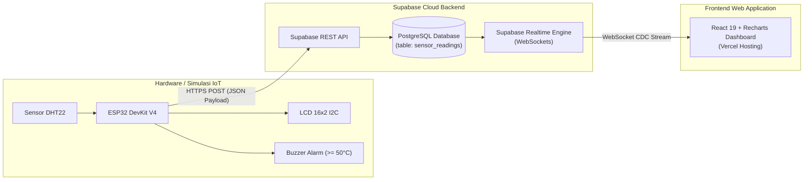

# 🌐 ESP32 IoT Monitoring Dashboard

<p align="center">
  
</p>

<p align="center">
  <b>Sistem Monitoring Suhu & Kelembapan Real-Time Berbasis ESP32, Supabase, dan React + Vite</b>
</p>

<p align="center">
  <a href="https://esp32-dashboard-nu.vercel.app/" target="_blank">
    
  </a>
  <a href="https://wokwi.com/projects/477206242817367041" target="_blank">
    
  </a>
</p>

<p align="center">
  <a href="https://github.com/dhidhin/esp32-dashboard/actions/workflows/ci.yml">
    
  </a>
  <a href="https://react.dev/">
    
  </a>
  <a href="https://vite.dev/">
    
  </a>
  <a href="https://supabase.com/">
    
  </a>
  <a href="https://www.espressif.com/en/products/socs/esp32">
    
  </a>
  <a href="LICENSE">
    
  </a>
</p>

---

## 🔗 Live Demo & Simulasi Interaktif

Anda dapat mencoba ekosistem IoT ini langsung dari browser tanpa perlu menyiapkan perangkat keras fisik:

| Layanan | Tautan Akses | Deskripsi |
| :--- | :--- | :--- |
| 🌐 **Live Web Dashboard** | **[esp32-dashboard-nu.vercel.app](https://esp32-dashboard-nu.vercel.app/)** | Dashboard frontend monitoring suhu & kelembapan real-time yang dihosting di Vercel. |
| ⚡ **Simulasi Hardware (Wokwi)** | **[Proyek Wokwi ESP32 + API](https://wokwi.com/projects/477206242817367041)** | Simulasi sirkuit virtual ESP32 + DHT22 + LCD 16x2 + Buzzer yang langsung terhubung ke database Supabase. |

> ### 💡 Cara Menguji Real-Time Secara Langsung:
> 1. Buka [Simulasi Wokwi](https://wokwi.com/projects/477206242817367041) di satu jendela browser, lalu klik tombol **Play / Start Simulation**.
> 2. Buka [Web Dashboard](https://esp32-dashboard-nu.vercel.app/) di jendela browser lain atau perangkat ponsel.
> 3. Klik sensor **DHT22** di Wokwi dan geser slider suhu / kelembapan.
> 4. Perhatikan dashboard web: nilai suhu, kartu status, dan grafik akan langsung berubah secara real-time via WebSocket tanpa perlu me-refresh halaman!
> 5. *(Bonus)* Coba atur suhu di Wokwi hingga **$\ge 50^\circ\text{C}$**: alarm buzzer akan otomatis berbunyi dan LCD menampilkan indikator `!ALR` (*Overheat Alert*).

---

## 📌 Ringkasan Proyek

**ESP32 IoT Monitoring Dashboard** adalah sistem IoT terintegrasi untuk pemantauan suhu dan kelembapan secara langsung (*real-time*). Proyek ini menggabungkan perangkat keras mikrokontroler **ESP32**, basis data cloud **Supabase (PostgreSQL)**, dan antarmuka web modern berbasis **React 19** dan **Vite**.

Data sensor dikirim secara periodik oleh ESP32 melalui HTTPS POST REST API ke Supabase. Perubahan data (*insert*) secara otomatis dipancarkan ke browser klien menggunakan **Supabase Realtime WebSockets** (Change Data Capture / CDC), menghasilkan pengalaman monitoring yang mulus dan minim latensi.

---

## ✨ Fitur Utama

- ⚡ **Pembaruan Data Real-Time**: Integrasi WebSocket melalui Supabase Realtime channel (`sensor-readings-realtime`).
- 📊 **Kartu Statistik Dinamis**:
  - **Suhu (°C)** dengan label status otomatis (*Dingin* < 20°C, *Normal* < 30°C, *Hangat* < 35°C, *Panas* $\ge$ 35°C).
  - **Kelembapan (%)** dengan indikator kenyamanan (*Kering* < 40%, *Normal* $\le$ 70%, *Lembap* > 70%).
  - **Indikator Online / Offline**: Menghitung waktu *heartbeat* sejak pembacaan terakhir (< 60 detik = Online).
- 📈 **Grafik Tren Interaktif (Recharts)**: Menampilkan visualisasi garis multi-parameter untuk 30 pembacaan terakhir.
- 📋 **Tabel Log Sensor**: Riwayat 10 pembacaan terbaru dengan format waktu lokal Indonesia.
- 🚨 **Sistem Alarm Hardware (Wokwi / ESP32)**:
  - Layar LCD 16x2 I2C menampilkan pembacaan lokal.
  - Buzzer berbunyi otomatis saat suhu terdeteksi ekstrem ($\ge 50^\circ\text{C}$).
- 📱 **Antarmuka Responsif & Modern**: Tampilan ramah pengguna pada layar desktop, tablet, maupun smartphone.

---

## 🏛️ Arsitektur Sistem



---

## 🛠️ Komponen Hardware & Rangkaian

### Komponen:
1. **ESP32 Development Board** (NodeMCU-32S / ESP32 DevKit C V4)
2. **Sensor Suhu & Kelembapan DHT22** (AM2302)
3. **Display LCD 1602** dengan modul I2C Backpack
4. **Active Buzzer** (sebagai alarm *overheat*)
5. **Kabel Jumper & Breadboard**

### Skema Pinout:

| Komponen | Pin Modul | Pin ESP32 | Keterangan |
| :--- | :--- | :--- | :--- |
| **DHT22** | **VCC** | **3V3** | Daya 3.3V sensor |
| | **DATA / SDA** | **GPIO 13** | Jalur sinyal data sensor |
| | **GND** | **GND** | Ground |
| **LCD 1602 I2C** | **VCC** | **VIN / 5V** | Daya modul LCD |
| | **GND** | **GND** | Ground |
| | **SDA** | **GPIO 21** | Jalur Data I2C |
| | **SCL** | **GPIO 22** | Jalur Clock I2C |
| **Buzzer** | **Positif (+)** | **GPIO 14** | Sinyal kendali alarm |
| | **Negatif (-)** | **GND** | Ground |

> 📁 Skrip firmware lengkap tersedia di [`firmware/esp32_dht22.ino`](firmware/esp32_dht22.ino) atau jalankan langsung di [Simulasi Wokwi](https://wokwi.com/projects/477206242817367041).

---

## 🗄️ Konfigurasi Database Supabase

1. Buka [Supabase Dashboard](https://supabase.com/dashboard) dan buat proyek baru.
2. Buka menu **SQL Editor**, salin dan jalankan skrip dari file [`supabase/schema.sql`](supabase/schema.sql):

```sql
-- 1. Buat tabel sensor_readings
CREATE TABLE IF NOT EXISTS public.sensor_readings (
    id BIGINT GENERATED BY DEFAULT AS IDENTITY PRIMARY KEY,
    suhu NUMERIC(5, 2) NOT NULL,
    kelembapan NUMERIC(5, 2) NOT NULL,
    created_at TIMESTAMP WITH TIME ZONE DEFAULT TIMEZONE('utc'::text, NOW()) NOT NULL
);

-- 2. Buat index performa
CREATE INDEX IF NOT EXISTS idx_sensor_readings_created_at_desc 
ON public.sensor_readings (created_at DESC);

-- 3. Konfigurasi Row Level Security (RLS)
ALTER TABLE public.sensor_readings ENABLE ROW LEVEL SECURITY;

CREATE POLICY "Allow public read access"
ON public.sensor_readings FOR SELECT TO anon, authenticated USING (true);

CREATE POLICY "Allow public insert access"
ON public.sensor_readings FOR INSERT TO anon, authenticated WITH CHECK (true);

-- 4. Aktifkan Supabase Realtime publication
ALTER PUBLICATION supabase_realtime ADD TABLE public.sensor_readings;
```

---

## 🚀 Panduan Menjalankan Frontend Secara Lokal

### 1. Prasyarat
- [Node.js](https://nodejs.org/) (versi 18 ke atas)
- NPM atau PNPM

### 2. Clone Repositori
```bash
git clone https://github.com/dhidhin/esp32-dashboard.git
cd esp32-dashboard
```

### 3. Pasang Dependensi
```bash
npm install
```

### 4. Konfigurasi Variabel Lingkungan
Salin file template `.env.example`:
```bash
cp .env.example .env
```
Isi variabel dengan URL dan Anon Key proyek Supabase Anda:
```env
VITE_SUPABASE_URL=https://your-project-id.supabase.co
VITE_SUPABASE_ANON_KEY=your_supabase_anon_key_here
```

### 5. Jalankan Local Development Server
```bash
npm run dev
```
Buka browser pada alamat `http://localhost:5173`.

### 6. Build untuk Produksi
```bash
npm run build
```
Folder hasil build `dist/` siap untuk di-deploy ke hosting statis pilihan Anda (Vercel, Netlify, Cloudflare Pages, dsb).

---

## 📂 Struktur Direktori Proyek

```text
esp32-dashboard/
├── .github/
│   ├── workflows/
│   │   └── ci.yml               # GitHub Actions CI Workflow
│   ├── ISSUE_TEMPLATE/
│   │   ├── bug_report.md        # Template laporan bug
│   │   └── feature_request.md   # Template permintaan fitur baru
│   └── pull_request_template.md # Template Pull Request
├── firmware/
│   └── esp32_dht22.ino          # Skrip ESP32 + DHT22 + LCD I2C + Buzzer (Wokwi-compatible)
├── public/
│   ├── favicon.svg              # Favicon dashboard
│   └── icons.svg                # Icon sprite SVG
├── src/
│   ├── assets/                  # File aset gambar
│   ├── lib/
│   │   └── supabase.js          # Inisialisasi Supabase client
│   ├── App.css                  # Styling dashboard
│   ├── App.jsx                  # Logika & komponen dashboard
│   ├── index.css                # Styling global
│   └── main.jsx                 # Entry point React
├── supabase/
│   └── schema.sql               # Skrip skema database, RLS, & Realtime
├── .env.example                 # Contoh variabel lingkungan
├── .gitignore                   # Daftar file yang diabaikan Git
├── CONTRIBUTING.md              # Panduan kontribusi
├── LICENSE                      # Lisensi MIT
├── package.json                 # Konfigurasi dependensi & npm scripts
└── README.md                    # Dokumentasi utama proyek
```

---

## 🧰 Skrip Perintah (NPM Scripts)

| Perintah | Keterangan |
| :--- | :--- |
| `npm run dev` | Menjalankan server lokal Vite dengan Hot Module Replacement (HMR). |
| `npm run build` | Mengompilasi dan mengoptimasi aplikasi web ke folder `dist/`. |
| `npm run lint` | Menjalankan [oxlint](https://oxc.rs) untuk audit kualitas kode. |
| `npm run preview` | Menjalankan pratinjau lokal dari hasil kompilasi folder `dist/`. |

---

## 🤝 Kontribusi

Tertarik menambahkan fitur atau memperbaiki bug? Silakan baca panduan lengkap pada [CONTRIBUTING.md](CONTRIBUTING.md) sebelum membuat Pull Request.

---

## 📜 Lisensi

Proyek ini berada di bawah naungan lisensi **MIT**. Rincian lengkap dapat dibaca pada file [LICENSE](LICENSE).

---

<p align="center">
  Dibuat dengan ❤️ oleh <a href="https://github.com/dhidhin"><b>Dhidhin Haris</b></a> &middot; XII RPL
</p>
