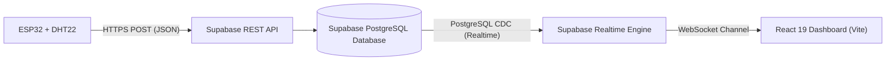

# 🌐 ESP32 IoT Monitoring Dashboard

<p align="center">
  
</p>

<p align="center">
  <b>Sistem Monitoring Suhu & Kelembapan Real-Time Berbasis ESP32, Supabase, dan React + Vite</b>
</p>

<p align="center">
  <a href="https://github.com/dhidhin/esp32-dashboard/actions/workflows/ci.yml">
    
  </a>
  <a href="https://react.dev/">
    
  </a>
  <a href="https://vite.dev/">
    
  </a>
  <a href="https://supabase.com/">
    
  </a>
  <a href="https://www.espressif.com/en/products/socs/esp32">
    
  </a>
  <a href="LICENSE">
    
  </a>
</p>

---

## 📌 Ringkasan Proyek

**ESP32 IoT Monitoring Dashboard** adalah aplikasi web monitoring IoT real-time modern yang menampilkan pembacaan sensor suhu dan kelembapan dari mikrokontroler **ESP32** (menggunakan sensor **DHT22** / **DHT11**).

Data dikirimkan oleh ESP32 melalui REST API ke basis data **Supabase (PostgreSQL)**, kemudian disiarkan langsung (*pushed*) ke dashboard React melalui **Supabase Realtime WebSockets** tanpa perlu melakukan reload halaman (*no polling*).

---

## ✨ Fitur Utama

- ⚡ **Pembaruan Real-Time (WebSockets)**: Data baru dari ESP32 langsung muncul di dashboard secara instan menggunakan Supabase Realtime channel.
- 📊 **Kartu Statistik Interaktif**:
  - **Suhu (°C)** dengan label status otomatis (*Dingin*, *Normal*, *Hangat*, *Panas*).
  - **Kelembapan (%)** dengan status otomatis (*Kering*, *Normal*, *Lembap*).
  - **Status ESP32**: Indikator *ONLINE / OFFLINE* dinamis berdasarkan *heartbeat* waktu pembaruan terakhir (< 60 detik).
- 📈 **Grafik Interaktif Recharts**: Visualisasi garis tren suhu dan kelembapan untuk 30 pembacaan data terakhir.
- 📋 **Tabel Riwayat Data**: Menampilkan 10 log data sensor terbaru lengkap dengan format waktu lokal Indonesia.
- 🎨 **Tampilan Responsif & Modern**: Desain antarmuka bersih, cepat, dan nyaman diakses baik dari desktop maupun smartphone.

---

## 🏛️ Arsitektur Sistem



---

## 🛠️ Komponen Hardware & Rangkaian

### Komponen yang Dibutuhkan:
1. **ESP32 Development Board** (NodeMCU-32S / ESP-WROOM-32).
2. **Sensor DHT22 / AM2302** (atau DHT11).
3. **Resistor 10kΩ** (sebagai *pull-up*, opsional jika modul sensor sudah terpasang resistor bawaan).
4. **Kabel Jumper** (Male to Female / Male to Male).
5. **Kabel Micro-USB / Type-C** untuk flashing & daya ESP32.

### Skema Pinout:

| Pin Sensor DHT22 | Pin ESP32 | Keterangan |
| :--- | :--- | :--- |
| **VCC** | **3V3** atau **VIN (5V)** | Sumber daya sensor |
| **DATA** | **GPIO 4** | Jalur sinyal data sensor |
| **GND** | **GND** | Ground bersama |

> 📁 Kode firmware ESP32 siap pakai tersedia pada direktori [`firmware/esp32_dht22.ino`](firmware/esp32_dht22.ino).

---

## 🗄️ Konfigurasi Database Supabase

Sebelum menjalankan aplikasi, siapkan tabel dan kebijakan akses di Supabase:

1. Buka [Supabase Dashboard](https://supabase.com/dashboard) dan buat proyek baru.
2. Buka menu **SQL Editor**.
3. Jalankan skrip SQL yang ada pada file [`supabase/schema.sql`](supabase/schema.sql):

```sql
-- Buat tabel sensor_readings
CREATE TABLE IF NOT EXISTS public.sensor_readings (
    id BIGINT GENERATED BY DEFAULT AS IDENTITY PRIMARY KEY,
    suhu NUMERIC(5, 2) NOT NULL,
    kelembapan NUMERIC(5, 2) NOT NULL,
    created_at TIMESTAMP WITH TIME ZONE DEFAULT TIMEZONE('utc'::text, NOW()) NOT NULL
);

-- Index created_at
CREATE INDEX IF NOT EXISTS idx_sensor_readings_created_at_desc 
ON public.sensor_readings (created_at DESC);

-- Aktifkan RLS dan Kebijakan Akses
ALTER TABLE public.sensor_readings ENABLE ROW LEVEL SECURITY;

CREATE POLICY "Allow public read access"
ON public.sensor_readings FOR SELECT TO anon, authenticated USING (true);

CREATE POLICY "Allow public insert access"
ON public.sensor_readings FOR INSERT TO anon, authenticated WITH CHECK (true);

-- Aktifkan Supabase Realtime
ALTER PUBLICATION supabase_realtime ADD TABLE public.sensor_readings;
```

---

## 🚀 Panduan Memulai (Instalasi & Penggunaan)

### 1. Prasyarat
- [Node.js](https://nodejs.org/) versi 18 atau lebih baru.
- Akun [Supabase](https://supabase.com).
- [Arduino IDE](https://www.arduino.cc/en/software) untuk mengunggah program ke ESP32.

### 2. Clone Repositori
```bash
git clone https://github.com/dhidhin/esp32-dashboard.git
cd esp32-dashboard
```

### 3. Pasang Dependensi
```bash
npm install
```

### 4. Konfigurasi Environment Variables
Salin file `.env.example` menjadi `.env`:
```bash
cp .env.example .env
```
Buka file `.env` dan masukkan kredensial Supabase Anda:
```env
VITE_SUPABASE_URL=https://your-project-id.supabase.co
VITE_SUPABASE_ANON_KEY=your_supabase_anon_key_here
```

### 5. Jalankan Aplikasi di Mode Development
```bash
npm run dev
```
Akses dashboard di browser melalui URL yang tampil pada terminal (biasanya `http://localhost:5173`).

### 6. Build untuk Mode Produksi
```bash
npm run build
```
Hasil build akan tersimpan di dalam folder `dist/` dan siap di-deploy ke Vercel, Netlify, atau GitHub Pages.

---

## 📂 Struktur Direktori Proyek

```text
esp32-dashboard/
├── .github/
│   ├── workflows/
│   │   └── ci.yml               # GitHub Actions CI Workflow
│   ├── ISSUE_TEMPLATE/
│   │   ├── bug_report.md        # Template laporan bug
│   │   └── feature_request.md   # Template permintaan fitur baru
│   └── pull_request_template.md # Template Pull Request
├── firmware/
│   └── esp32_dht22.ino          # Skrip program Arduino/ESP32
├── public/
│   ├── favicon.svg              # Ikon dashboard
│   └── icons.svg                # Sprite SVG icons
├── src/
│   ├── assets/                  # Aset gambar & ilustrasi
│   ├── lib/
│   │   └── supabase.js          # Inisialisasi Supabase Client
│   ├── App.css                  # Styling dashboard
│   ├── App.jsx                  # Komponen utama dashboard IoT
│   ├── index.css                # Global styling & reset
│   └── main.jsx                 # Entry point React
├── supabase/
│   └── schema.sql               # Skrip SQL tabel, RLS & Realtime
├── .env.example                 # Template variabel lingkungan
├── .gitignore                   # Konfigurasi file yang diabaikan git
├── CONTRIBUTING.md              # Panduan kontribusi
├── LICENSE                      # Lisensi proyek (MIT)
├── package.json                 # Metadata & dependensi proyek
└── README.md                    # Dokumentasi utama proyek
```

---

## 🧰 Skrip yang Tersedia

Di dalam file `package.json`, terdapat skrip-skrip berikut yang dapat dijalankan:

| Perintah | Fungsi |
| :--- | :--- |
| `npm run dev` | Menjalankan server pengembangan Vite lokal dengan Hot Module Replacement (HMR). |
| `npm run build` | Melakukan proses kompilasi & optimasi kode ke folder `dist` untuk kebutuhan produksi. |
| `npm run lint` | Menjalankan [oxlint](https://oxc.rs) untuk memeriksa kualitas dan standar kode. |
| `npm run preview` | Menjalankan pratinjau hasil build lokal sebelum diunggah ke server hosting. |

---

## 🤝 Kontribusi

Kontribusi selalu diterima dengan senang hati! Silakan pelajari panduan kontribusi di [CONTRIBUTING.md](CONTRIBUTING.md) sebelum membuka Pull Request.

---

## 📜 Lisensi

Proyek ini dilisensikan di bawah lisensi **MIT** - lihat file [LICENSE](LICENSE) untuk informasi selengkapnya.

---

<p align="center">
  Dibuat dengan ❤️ oleh <a href="https://github.com/dhidhin"><b>Dhidhin</b></a> &middot; XII RPL
</p>
